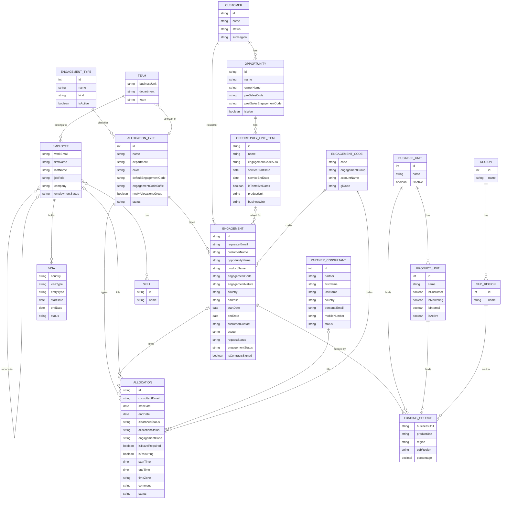

# Domain model

An engagement is the unit of work, raised against a customer account or the organization itself, funded by one or more business units, and staffed by allocations of consultants, who are either staff or partner consultants. Engagement types, allocation types and the org structure classify them.

An `ENGAGEMENT` carries two lifecycles, its request status and its engagement status (F1), and an `ALLOCATION` its clearance status (F4). An allocation with no engagement is a team default allocation (F5). A `TEAM` is the business unit, department and team triple the HR system reports for an employee. `CUSTOMER`, `OPPORTUNITY`, `OPPORTUNITY_LINE_ITEM`, `EMPLOYEE`, `VISA` and `SKILL` are owned by the sales, HR, finance and skills systems the app reads from; `ENGAGEMENT`, `ALLOCATION` and `FUNDING_SOURCE` are written through the finance system; the rest are the app's own.