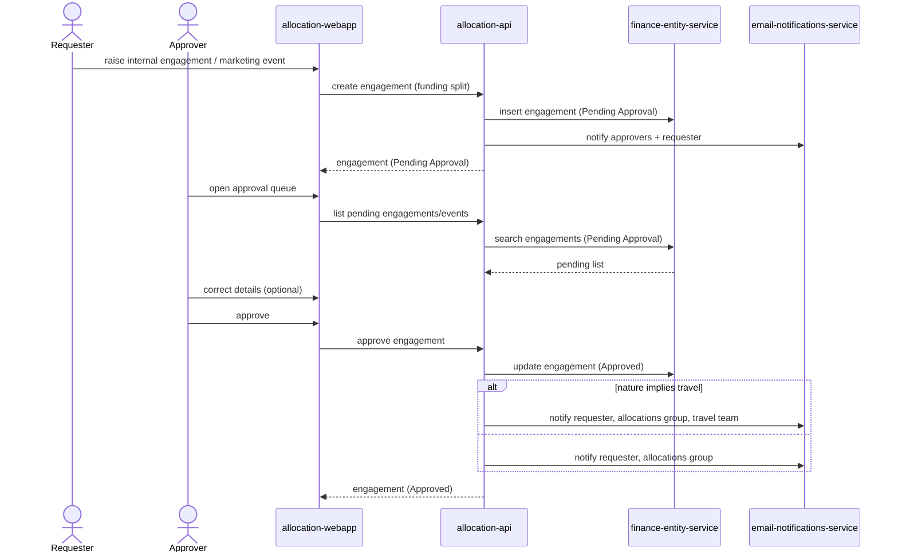

# Raise and approve an internal engagement or marketing event

A Requester raises an internal engagement or marketing event with split funding, and an Approver reviews and approves it before anyone is allocated. (F2, F3)

