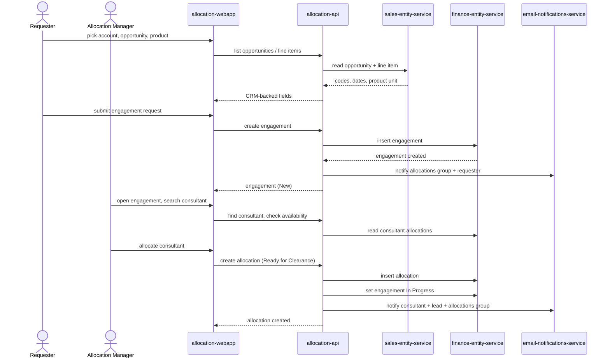

# Raise and allocate a customer engagement

A Requester raises a customer engagement from a CRM opportunity, and an Allocation manager staffs it with a consultant, who is cleared and notified. (F1, F4)

